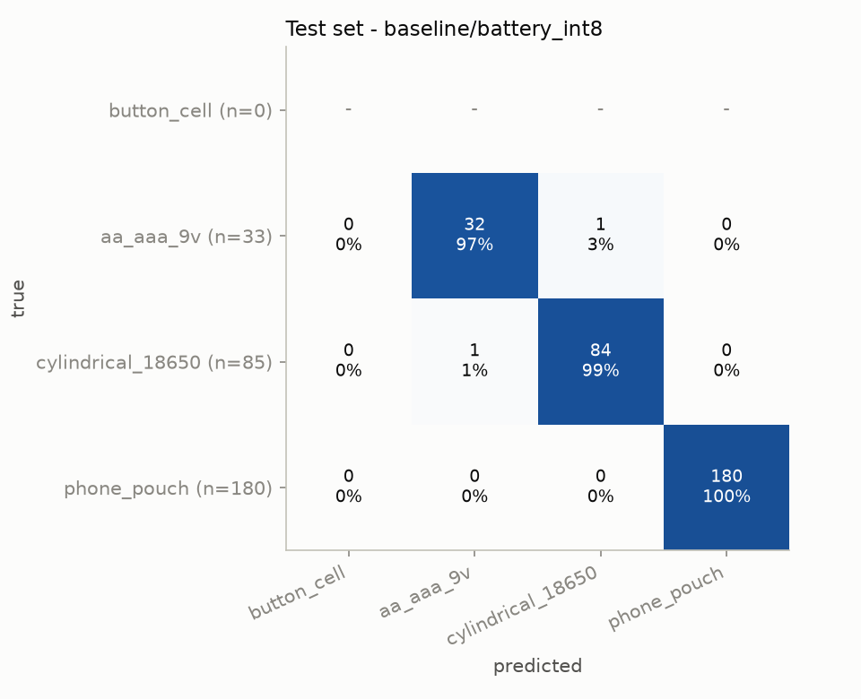
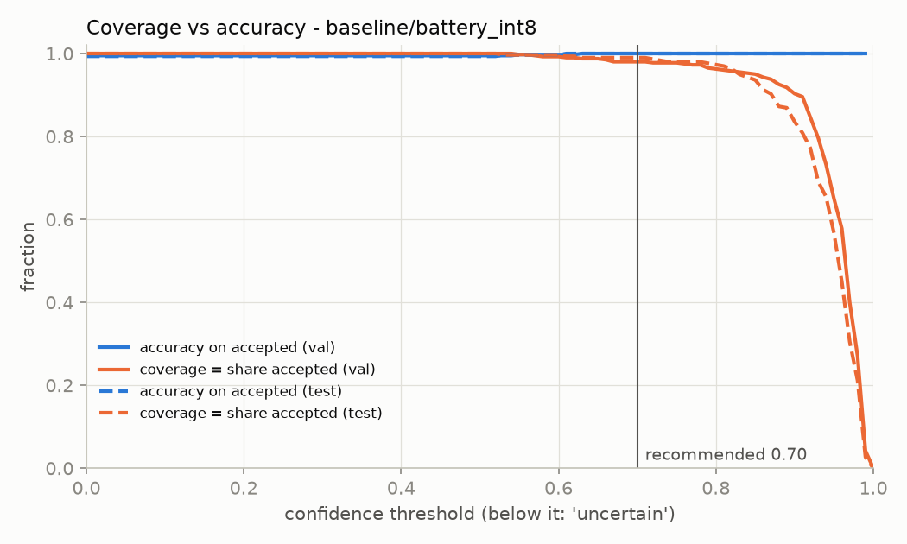

# Battery shape classifier: build report

Date of this run: 2026-10-23. Everything below happened on this PC, inside `C:\Users\aarav\Downloads\battery-ml`.

> **Read this first.** The model was trained only on public images: the RecyBat24 lab photos, product photos
> scraped by the Singapore dataset authors, and Wikimedia Commons photos. None of them come from your camera,
> angle, tray, lighting or ~70 mm distance. **The accuracy numbers below are a baseline for "public data looks
> like public data". Expect noticeably worse results on your device until you add your own photos.**
> **button_cell has no real device photos at all, so every button_cell number here is UNRELIABLE.**

**Headline (official run, `logs/pipeline_20261023_202718.log`):**

| | |
|---|---|
| Shipped model | `models/battery_int8.tflite` (2.7 MB), MobileNetV2 224 px, baseline variant (no synthetic data) |
| Held-out test accuracy | **99.3%** (296/298 images, 3 classes; no button_cell in test, see below) |
| int8 vs float32 | same test accuracy (99.3% both), 3.3× smaller, so int8 is recommended |
| "Uncertain" threshold | **0.70** (test: 99.0% of images accepted, 100% of accepted correct) |
| button_cell | 24/24 held-out Wikimedia photos correct: **UNRELIABLE**, not a device result |
| Shortcut diagnostic | **88.9%**. AA cells pasted onto the RecyBat24 tray were recognised only **78%** of the time, which is evidence the model partly uses *background/source* instead of shape (§9.3) |

The 99% figure mostly says "these public datasets are easy to tell apart". It does **not** predict how the
model will do on your rig.

---

## 1. The one command

From the project folder (cmd, PowerShell, or double-click):

```
run_pipeline.bat
```

It runs every step in order: fetch (cached), prepare, split, synthetic experiment, train both variants,
export to TFLite, evaluate, calibrate, and publish to `models/`. Options: `run_pipeline.bat -Background`
(detached, log in `logs/`), `-Fresh` (discard old training runs), and `-RefreshWeb` (look for new Wikimedia
files, which then need a visual review).
Re-run it after adding photos to `data/own/<class>/<battery_id>/` (see `data/own/README.md`). Training
retrains from scratch automatically when the split changes, and resumes from the last epoch after a crash. The
log of every run goes to `logs/pipeline_<timestamp>.log`, and per-epoch training logs go to
`runs/<variant>/log_head.csv` and `log_ft.csv`.

## 2. Hardware and environment decisions

| Decision | What and why |
|---|---|
| GPU | `nvidia-smi` found an **NVIDIA GeForce RTX 5070, 12 GB** (driver 610.88, CUDA 13.3). |
| GPU framework | TensorFlow has had no GPU support on native Windows since 2.10 (it says so itself at import), and WSL2 would mean installing things outside this folder. So training uses **Keras 3 on the PyTorch backend** (torch 2.14.1 + CUDA 13.2, which supports the RTX 50-series `sm_120`). Export uses Keras 3 on the TensorFlow backend, because only TF has the TFLite converter. The weights file is backend-independent. The export step re-checks this: the TF-rebuilt model reproduces the torch-trained model's probabilities (max diff is in `reports/metrics.json` → `export_meta`). If the GPU is ever unavailable, `train.py` falls back to TensorFlow on CPU at 160 px. |
| Python | The only system Python was 3.15, which is too new for TensorFlow. A portable `uv` (in `tools/uv/`) installed **Python 3.12.15 inside `.cache/python/`**, with the venv in `.venv/`. All caches (pip/uv, Keras ImageNet weights, matplotlib) are redirected into `.cache/` by `tools/env.ps1`. Nothing was installed system-wide. |
| Input size | 224×224, MobileNetV2's native size (GPU available). |
| Packages | `requirements.txt` (pinned), plus torch via `uv pip install torch --torch-backend=auto`. |

## 3. Data sources and licenses

| Source | What | License | Used as |
|---|---|---|---|
| **RecyBat24** (Acaro Chacón et al., *Scientific Data* 12, 843 (2025); Zenodo record 15226091 v2) | 2,835 top-down 640×640 photos of Li-ion cells on a grey tray, COCO boxes for *cylindric / pouch / prismatic* | **CC-BY 4.0** (Zenodo record). Attribution required: cite the paper. | `cylindrical_18650`, `phone_pouch` |
| **Singapore Battery Dataset / BatSort** (Zhao et al., arXiv 2404.05802; github.com/FriedrichZhao/Singapore_Battery_Dataset) | ~500 product-style photos in 10 brand folders | **No license file in the repo, so by default all rights are reserved.** The README says the images were collected "from various sources such as Google Images and online shopping websites", so the copyright of each photo belongs to its original owner, not the dataset authors. | `aa_aaa_9v`, a few `cylindrical_18650` |
| **Wikimedia Commons**, categories *Button cells* and *Coin cells* (recursive) | 110 button/coin cell photos after review | Per file, all in {CC0, Public domain, CC BY 2.0/2.5/4.0, CC BY-SA 2.0/2.5/3.0/4.0}. Every file's author, license and URL is in `data/public/button_cell/SOURCES.csv`. | `button_cell` (web) |

**Decision on Singapore:** you asked for this dataset explicitly, so it is used. It is the *only* source of
alkaline-shaped cells. But it has no license and is itself scraped from Google and retailers, which is exactly
what you told me not to do for button cells. It is acceptable for a private student prototype, but **don't
redistribute those images or a model whose main claim rests on them**, and drop them once you have your own AA
photos (`USE_SINGAPORE = False` in `pipeline/config.py`). Emailing the authors for a license would settle it.

**CC-BY-SA note:** the share-alike Wikimedia images (and synthetic composites derived from them) carry SA terms
if you ever *publish the images*. Training a model on them for your project is fine. Keep `SOURCES.csv` with
the project for attribution.

## 4. Label mapping (and what was dropped)

| Dataset label | → class | Notes |
|---|---|---|
| RecyBat24 `cylindric` | `cylindrical_18650` | Checked visually: 18650 cells from laptop packs, including a few 2-cell packs. 479 crops. |
| RecyBat24 `pouch` | `phone_pouch` | Phone/tablet pouch batteries. 1,742 crops. |
| RecyBat24 `prismatic` | **dropped** | **660 boxes dropped**, as you instructed. Heads-up: in this dataset "prismatic" means small hard-case flat cells that look very like phone batteries from above. If you'd rather count them as flat Li-ion, set `RECYBAT_PRISMATIC_TO_POUCH = True`. |
| Singapore `Duracell_Alk, Energizer_Alk, Energizer_Ind, Energizer_Li, Exell_Green, Exell_Yellow, GP_Alk, IKEA_Alk, Other` | `aa_aaa_9v` | Mostly AA/AAA. Also a few C/D and one 9 V, all alkaline-shaped. `Energizer_Li` is AA lithium (AA shape). |
| Singapore `Klarus` | `cylindrical_18650` | Klarus 18650/21700 Li-ion cells. |
| **Dropped from Singapore by visual review: 17 images** | | 8 Klarus 14500 cells (AA-sized Li-ion, wrong shape for 18650), 6 `Other` (Panasonic 18650-type Li-ion, a BR-2/3A lithium cell, unclear small cells), 3 `Exell_Green` (looked like 3.7 V 18650s). The list is in `config.SINGAPORE_EXCLUDE`. |

RecyBat24 photos are overview frames where the battery covers a median ~7% of the image. I **cropped each
bounding box to a square 1.6× its longest side** (`CROP_MARGIN`), so each training image shows one battery,
closer to what your fixed camera sees. The dataset's own train/val split was ignored, because the same
physical batteries appear in both (see §7). Singapore images were padded to square with their own border
colour, so no black bars give away the source.

## 5. Button cells: what I searched and what I found

| Where | Result |
|---|---|
| Wikimedia Commons (public API, no login) | **Used.** 220 candidates → 35 rejected automatically (non-free license or GIF/SVG/TIFF) → 185 downloaded (640 px thumbnails) → **75 removed by visual review** (devices, circuit boards, holders, blister packs, collages, disassembled cells; reasons in `data/public/button_cell/EXCLUDED_web.csv`) → **110 kept** in `data/public/button_cell/web/`. |
| Roboflow Universe | Candidates, all CC BY 4.0 per their listings: `nhung-002/n1-s9ygf` (classes aa_battery / **button_battery** / c_battery), `ki-mkbov/battery-detection-grcmi` (9V, AA, AAA, **Coin Battery**), `fujiwara-takumi/denti2` (button / battery / 9v). **Downloading requires a free Roboflow account + API key, and the site blocked automated access, so I did not work around it.** |
| Kaggle | No dataset matched button/coin cells. Kaggle downloads need an account + API token anyway. |
| Hugging Face datasets | Searched "battery" (100 results): only robotics recordings and battery-health tables, no button cell images. |
| Open Images | Has no button-cell / coin-cell class, only generic objects. Not usable for this class. |
| IEEE DataPort "battery & non-battery objects data" (DOI 10.21227/2d4h-d552) | Has a button-cell category, but access needs an IEEE DataPort subscription/login. |
| Academic e-waste sorting papers | RecyBat24 and BatSort (both used) have no button cells. No other open button-cell image set found. |
| Google Images / retailers | **Not used**, per your instruction. |

**Rule 5e (button_cell never reaches the test set on web/synthetic images alone):** web button cells are split by
group into **train (86)** and a separate **`web_holdout` (24)** that is never trained on and never part of
val/test. Synthetic images are train-only. Until `data/own/button_cell/` has photos, the main test set has no
button_cell rows. Button metrics come only from `web_holdout` and are labelled **UNRELIABLE** everywhere.

### Synthetic compositing (labelled EXPERIMENT)

`pipeline/synth_buttons.py` cuts button cells out of **train-split** web photos only, and only where the photo
background is uniform and the mask passes shape checks (54 of 86 qualified). It then pastes them at random
scale (25–65% of the frame), rotation and position onto battery-free patches of the RecyBat24 tray (70%) or
plain/noisy colours (30%), with a soft drop shadow. That gives 8 composites per cut-out, **432 images, used in
training only** (never val, test or holdout). Two models are trained, `baseline` and `synthetic`. The synthetic
one is shipped only if it raises web-holdout button recall by ≥5 points while losing ≤1 point of validation
accuracy (decided on val + holdout, never on test). The result is in §9.

## 6. Image counts and class imbalance

Images actually used (after capping), per class / source / split:

| class / source | train | val | test | web_holdout |
|---|---|---|---|---|
| button_cell / web (Wikimedia) | 86 | 0 | 0 | 24 |
| button_cell / synthetic (experiment only) | 432 | 0 | 0 | 0 |
| aa_aaa_9v / singapore | 214 | 53 | 33 | 0 |
| cylindrical_18650 / recybat24 | 252 | 45 | 75 | 0 |
| cylindrical_18650 / singapore | 28 | 5 | 10 | 0 |
| phone_pouch / recybat24 | 516 | 300 | 180 | 0 |
| **own photos (all classes)** | **0** | **0** | **0** | n/a |

> ⚠ **button_cell is nearly empty: 86 real training images, none from a battery-sorting setting, and zero device
> photos.** It is not filled with fabricated data. The synthetic images are an opt-in experiment and were *not*
> used by the shipped model.
> ⚠ **aa_aaa_9v rests on 300 scraped product photos** from a single source with no license.

**Imbalance handling: both capping and class weights.**
1. *Capping redundancy:* RecyBat24 photographs each physical battery ~30 times. At most **12 training images per
   physical battery** are kept (`TRAIN_CAP_PER_GROUP`), which dropped 746 near-redundant pouch and 107 cylinder
   crops from training. Val/test are not capped. Your own photos are never capped.
2. *Class weights:* per-sample weights `N / (K · n_class)`, clipped to [0.5, 5]. In the baseline run that was
   button_cell 3.19, aa_aaa_9v 1.28, cylindrical_18650 0.98, phone_pouch 0.53.

## 7. Splitting and leakage (done before any augmentation)

* Split ratio 70/15/15 **by group, never by image**. Assignment is a stable hash of the group ID, so adding
  photos later doesn't reshuffle existing ones. Any class with ≥3 groups is guaranteed at least one group in val
  and in test.
* **Groups:** RecyBat24 filenames encode a physical-battery ID (`<id>_<pose>_<side>_<shot>_<cls>`), so all crops
  of one battery stay in one split. **The dataset's own train/val folders contain the same batteries**, which is
  why I ignored them. Your photos are grouped by sub-folder (one per physical battery).
* **Near-duplicates:** a 64-bit perceptual hash (pHash) on every image; pairs with Hamming distance ≤4 are merged
  into one group (30 pairs merged, all within Singapore/Wikimedia re-uploads and crops). I first ran this across
  everything, and it chained the RecyBat24 crops together (they share the same grey tray), collapsing 58 pouch
  batteries into ~10 groups. So pHash merging now skips pairs where *both* images already have an explicit
  group. Cross-class near-duplicates found: 0.
* **What this can't catch:** the same product photo re-shot or heavily re-edited by different shops in the
  Singapore set, and the fact that every RecyBat24 image shares one tray, camera and lighting. Splitting can't
  remove that second problem (§9.3).

## 8. Training

* MobileNetV2 (ImageNet weights, `include_top=False`, average pooling) → Dropout 0.3 → Dense(4, softmax). Pixel
  scaling to [-1, 1] is inside the model, so it takes raw 0–255 RGB.
* **Phase 1:** base frozen, head trained with Adam 1e-3, up to 15 epochs, early stopping on val loss (patience 4).
* **Phase 2:** fine-tune from `block_13_expand` to the top (26 layers, ~last three inverted-residual blocks +
  final conv), BatchNorm kept frozen in inference mode, Adam **1e-5**, up to 25 epochs, ReduceLROnPlateau and
  early stopping (patience 6).
* Loss: categorical cross-entropy with label smoothing 0.05 (softens over-confidence, which helps the threshold).
* **Augmentation (training only, on the fly; val/test/holdout never augmented):** full 0–360° rotation (a battery
  can lie any way in the tray), zoom ±15%, shift ±10% (one affine warp, reflect padding), horizontal and vertical
  flips, brightness ±20%, contrast 0.7–1.3, mild saturation 0.8–1.2 (my addition, for white-balance drift), and
  Gaussian blur σ 0.4–1.8 on 30% of images.
* Images are padded to square with their own border colour, then resized to 224. `infer_pi.py` does exactly the
  same.
* Time: ~1.3 min per variant on the RTX 5070. The whole pipeline takes ~5 min.
* Crash safety: `BackupAndRestore` checkpoints every epoch, finished phases are skipped on restart, and the
  runner retries a failed training step twice (resuming).
* Run-to-run variation: GPU kernels aren't bit-deterministic, so two runs differ by 1–2 test images. The first
  full run gave 99.7% / 99.3% (float32 / int8), the official run 99.3% / 99.3%.

## 9. Results

Full tables: `reports/RESULTS.md` (regenerated each run); raw numbers: `reports/metrics.json`.

### 9.1 Held-out test set (shipped model: baseline, int8)

| class | precision | recall | F1 | test images |
|---|---|---|---|---|
| button_cell | – | – | – | 0 (no own photos; see 9.2) |
| aa_aaa_9v | 0.970 | 0.970 | 0.970 | 33 |
| cylindrical_18650 | 0.988 | 0.988 | 0.988 | 85 |
| phone_pouch | 1.000 | 1.000 | 1.000 | 180 |
| **overall accuracy** | | | **99.3%** | 298 |



Both errors are **AA ↔ 18650 confusions on Singapore product photos** (test accuracy by source: RecyBat24
100%, Singapore 95.3%). Product photos have no scale reference, and an AA and an 18650 are both "a cylinder".
On your rig the fixed 70 mm distance makes size visible (an 18650 is ~30% longer than an AA), but only your own
photos can teach that. The load-cell weight helps too: alkaline AA ~23 g vs 18650 ~45 g.

### 9.2 button_cell: UNRELIABLE

24/24 held-out Wikimedia button-cell photos were classified as button_cell, and no non-button test image was
called a button cell. **This says almost nothing about your device:** the held-out photos are close-ups of coin
cells on white backgrounds, visually unlike everything else in the data. Real-world risks it can't measure:
coins, washers and metal buttons (no negative class exists), button cells photographed small in a tray, and
tabbed or corroded cells.

### 9.3 Shortcut diagnostic: is it learning shape or background?

Every pouch and most 18650 images come from one grey tray, while all AA images are product shots. A model can
score 99% by recognising the *dataset* instead of the battery. To test that, held-out (test/holdout) product
photos were cut out and pasted onto battery-free RecyBat24 tray patches (81 images). This is reported
separately and never mixed into the test numbers:

| class (on tray) | recall | n |
|---|---|---|
| button_cell | 97.9% | 48 |
| aa_aaa_9v | **77.8%** | 27 |
| cylindrical_18650 | 66.7% | 6 |

AA cells on the tray are often called **cylindrical_18650**, because "grey tray + cylinder" was always an 18650 in
training. **This is the clearest evidence that real device photos of every class are needed,** shot on the same
tray so background can't separate the classes.

### 9.4 Synthetic button-cell experiment: no measurable effect, not used

| | baseline | +432 synthetic |
|---|---|---|
| val accuracy (float32) | 99.8% | 99.8% |
| test accuracy (float32 / int8) | 99.3% / 99.3% | 99.7% / 100.0% |
| web-holdout button recall | 100% | 100% |
| diagnostic: button cells on tray | 97.9% | 100% (1 image) |
| diagnostic overall (float32 / int8) | 88.9% / 88.9% | 87.7% / 90.1% |

**Verdict: it neither clearly helped nor hurt.** The web holdout is saturated at 100% for both, and the other
differences are 1–2 images, within the run-to-run noise. Under the pre-set rule (≥5-point button-recall gain on
the holdout), the baseline ships. The experiment stays in the pipeline (`SYNTHETIC_MODE = "experiment"`) and will
become meaningful once your button photos are in val/test. My expectation is that it helps a little when real
button data is scarce and stops mattering after ~200 real photos.

### 9.5 Confidence threshold ("uncertain")



| threshold | val accepted | val acc on accepted | test accepted | test acc on accepted | **shifted (diagnostic) accepted** | **shifted acc on accepted** |
|---|---|---|---|---|---|---|
| 0.50 | 100.0% | 99.5% | 100.0% | 99.3% | 90.1% | 91.8% |
| 0.60 | 99.3% | 99.8% | 99.7% | 99.7% | 82.7% | 92.5% |
| **0.70** | **98.0%** | **100%** | **99.0%** | **100%** | **74.1%** | **93.3%** |
| 0.80 | 96.3% | 100% | 97.3% | 100% | 60.5% | 93.9% |
| 0.90 | 90.3% | 100% | 83.6% | 100% | 28.4% | 95.7% |

**Recommendation: 0.70** (stored per model in `models/model_info.json`, used by `infer_pi.py` automatically).
Honest caveat: the public validation set is *saturated*. It's 100% correct above 0.6, so pure val calibration
("lowest threshold with ≥98% selective accuracy") returns 0.00, which is meaningless. The 0.70 comes from a
documented floor (`THRESHOLD_FLOOR`), chosen because on the domain-shifted diagnostic set it halved the confident
mistakes (6 → 3 in the first run) at the cost of rejecting ~1 in 4 shifted images, while rejecting only ~1–2% of
in-distribution images. For a safety device, "uncertain → treat as hazardous / ask a human" is the cheap side of
the trade. Even so, **some wrong answers on shifted data had confidence 0.89–0.98**. No threshold fixes a domain
gap, only data does. Re-calibrate once your photos are in validation (automatic on re-run).

## 10. Export and the Pi

| file | size | test acc | notes |
|---|---|---|---|
| `models/battery_float32.tflite` | 8.7 MB | 99.3% | input float32 [1,224,224,3], 0–255 |
| `models/battery_int8.tflite` | 2.7 MB | 99.3% | **recommended**. Full-integer, input **uint8** 0–255, output float32 probabilities. Calibrated on 300 real (un-augmented) training images. |

int8 accuracy holds up (0.0-point drop on test, max probability difference vs Keras ≈0.03), so it ships as the
default. Also in `models/`: `labels.txt`, `model_info.json` (recommended file, thresholds, preprocessing),
and a copy of `infer_pi.py`. **Copy the whole `models/` folder to the Pi.**

**Runtime choice (checked on 2026-10-23, not assumed):** Debian 13 "trixie" ships **Python 3.13**.
`tflite-runtime`'s last release is 2.14.0 (Oct 2023) with aarch64 wheels only for Python 3.8–3.11, so it
**won't install on Debian 13**. Google's own "Python on Linux devices" LiteRT page still shows
`pip install tflite-runtime`, but that page is out of date. **`ai-edge-litert` 2.3.0** (6 Oct 2026, the renamed
TFLite runtime) has `manylinux_2_27_aarch64` wheels for CPython 3.10–3.14, so that's what `infer_pi.py` uses
(`from ai_edge_litert.interpreter import Interpreter`, with a fallback import of `tflite_runtime`). Requirements:
**64-bit OS** (there are no armhf wheels) and a venv (Debian 13 blocks system-wide pip, PEP 668). On the Pi, while
online:

```bash
python3 -m venv ~/battery-venv
~/battery-venv/bin/pip install ai-edge-litert pillow
~/battery-venv/bin/python models/infer_pi.py photo.jpg            # -> "phone_pouch 0.996 [OK, threshold 0.70, ...]"
~/battery-venv/bin/python models/infer_pi.py photo.jpg --json     # one JSON line for your rule layer
```

For an offline Pi, download the wheels and their dependencies (numpy etc.) on any PC:
`pip download ai-edge-litert pillow --platform manylinux_2_27_aarch64 --platform manylinux_2_28_aarch64
--python-version 3.13 --only-binary=:all: -d wheels/`. Copy `wheels/` over and run
`pip install --no-index --find-links wheels ai-edge-litert pillow` inside the venv.
I tested `infer_pi.py` here on Windows with the same `ai-edge-litert` 2.3.0 package. **I could not test it on a
Pi.** Expected latency for MobileNetV2-224 int8 on a Pi 4 is very roughly 50–100 ms (unmeasured). The JSON
output includes `inference_ms` so you can check.

## 11. Should you add an `empty_tray` class? Yes, plus an `other_object` class

* **Why:** softmax has no "none of the above". With only four classes, an empty tray, a coin, a screw or a hand
  will still be called one of the four, often with high confidence (the diagnostic showed wrong answers at
  0.9+). The threshold catches some of that, not all.
* **`empty_tray`** is the cheapest class you'll ever collect (100–150 photos across your lighting conditions,
  no batteries needed). It lets the camera check itself: is the tray clear, did the battery fall off, is the
  lens dirty or the light broken. The load cell can also detect "empty", and the two can cross-check each
  other: weight > 0 but camera says empty means an object is outside the camera's view.
* **More important still: `other_object`** (coins, washers, screws, keys, PCB scraps, plastic). A coin is the same
  size as a CR2032 and a similar weight (CR2032 ≈ 3 g), so **neither the camera model nor the scale can currently
  tell a coin from a button cell**. In a hazard device, a "button cell" verdict on a coin is a false alarm, while
  a coin verdict on a button cell would be dangerous. Collect 200–300 photos.
* Adding a class means adding a folder name to `CLASSES` in `pipeline/config.py` and `data/own/<name>/`, then
  re-running. Nothing else changes.

## 12. Weaknesses (blunt)

1. **Domain gap.** No image was taken with your camera, angle, tray, lighting or 70 mm distance. Expect a real
   drop, possibly large, on the device. The 99% is a ceiling for public-looking images, not a forecast.
2. **Source = class confound.** aa_aaa_9v = product shots only; phone_pouch = RecyBat24 tray only. The model
   partly learned the background (§9.3: AA on tray → 78%). This is the biggest technical flaw and only same-rig
   photos of every class fix it.
3. **button_cell has no device data** and only 86 real training images. Its 100% is meaningless for the
   device. No negative class means coins will likely be called button cells.
4. **Scale is invisible in the public data** (crops and product shots). AA vs 18650 vs 21700 is mostly a size
   difference, and the model hasn't learned size. 14500 Li-ion cells are AA-shaped and **will be called
   aa_aaa_9v** (shape-only can't fix that; weight is similar too). Your rule layer should treat
   "aa_aaa_9v + unusual weight" carefully.
5. **Small, clustered test set.** 298 images, but the 180 pouch test images come from only **6 physical
   batteries**, and the 85 cylinder images come from **5 physical cells** (75 crops) plus 10 product photos.
   AA: 33 photos from 31 groups. One AA image is ~3 points of recall. Effective sample sizes are tiny, so the
   confidence intervals are wide.
6. **Licensing:** the Singapore images have no license and come from scrapes. CC-BY-SA terms apply if you
   publish Wikimedia-derived images.
7. **Threshold** is set by a documented floor, not by validation (validation is saturated). Recalibrate with own
   data.
8. **Prismatic cells were dropped** per your instruction, so a hard-case phone/camera battery will be forced into
   one of the four classes (probably phone_pouch).
9. **No Pi test.** The model and script were run with the same LiteRT package on Windows, not on ARM.
10. Visual curation (Singapore exclusions, Wikimedia review) was done by me by eye. It's documented, but a
    second pair of eyes is worth it.

## 13. What to photograph next

General rules for every class: **use the real device** (same camera, 70 mm, tray, light). Put **each physical
battery in its own sub-folder** (`data/own/<class>/<battery_id>/`). Aim for **10–15 photos per battery** and many
different batteries: diversity of *batteries* beats more shots of one. For every battery, vary:
* **position:** centre, each of the 4 quadrants, touching each tray edge/corner (≈ 6 positions)
* **rotation:** 0/45/90/135° (any angle is fine; the model rotates anyway, but real shadows differ)
* **face:** both faces / both ends visible where the battery has them
* **lighting:** device light only (main case), room light on, daylight from a window, one side-lit with a phone
  torch (hard shadows), dim
* **condition:** clean, dusty/dirty, label torn off, dented, corroded/leaking (wear gloves), with tabs or wires,
  with tape or stickers

| class | photos | distinct batteries | include |
|---|---|---|---|
| button_cell | **300–500** | ≥40 | see shot-list below |
| aa_aaa_9v | 300–400 | ≥40 | AA, AAA, C, D, 9 V (on its face and on its side), AAAA, A23. Alkaline, NiMH, zinc-carbon. New and leaky. Brand-new shrink-wrap and bare steel. |
| cylindrical_18650 | 300–400 | ≥40 | bare 18650s in many wrap colours, with welded nickel strips, still glued in 2–3-cell clusters, from laptop packs, 21700s, damaged/re-wrapped. Lay some **next to where an AA would be** so size is learnable. |
| phone_pouch | 300–400 | ≥40 | phone and tablet batteries (front + back), **swollen/puffy ones** (the most dangerous, so don't skip them), with flex cable, small earbud/smartwatch pouch cells, laptop pouch cells |
| empty_tray (new) | 100–150 | – | every lighting condition, with dust/scratches, slightly moved tray |
| other_object (new) | 200–300 | ≥50 objects | **coins (all local denominations, essential)**, washers, nuts, screws, keys, SIM tray, PCB fragments, plastic caps, a fingertip at the edge |

Minimum to make the metrics meaningful: ~**100 photos from ≥10 batteries per class**. That puts only ~1–2
batteries per class in test, so the 300+/≥40 targets above are what gives a trustworthy test set (~6 batteries
per class in test). The pipeline drops the UNRELIABLE label for button_cell as soon as your own button photos exist.

### Button-cell shot-list (exact)

Buy or collect ~45 cells. Old watches, car keys, scales, motherboards and hearing-aid shops are good e-waste
sources.

| size code | what it is | diameter × height | how many cells | why |
|---|---|---|---|---|
| CR2032 | 3 V lithium coin | 20 × 3.2 mm | 8 (≥3 brands, 2 used/scratched) | most common coin cell |
| CR2025 / CR2016 | lithium coin, thinner | 20 × 2.5 / 1.6 mm | 3 + 3 | same face as CR2032, thinner |
| CR2450 / CR2430 | large lithium coin | 24 × 5.0 / 3.0 mm | 2 + 1 | the biggest common coins (car keys, scales) |
| CR1220 / CR1632 / CR1616 | small lithium coin | 12–16 mm | 1 each | small coins |
| LR44 / AG13 (/ SR44, 357) | alkaline / silver-oxide button | 11.6 × 5.4 mm | 5 | toys, calipers. Thick "button" profile. |
| LR41 / AG3 (192) | small alkaline button | 7.9 × 3.6 mm | 3 | thermometers, laser pointers |
| SR626SW (377) / SR621 (364) | watch cell | 6.8 × 2.6 / 2.1 mm | 4 | smallest common cells, the hardest case at 70 mm |
| LR1130 / AG10 (389/390) | alkaline button | 11.6 × 3.1 mm | 3 | calculators |
| Zinc-air 675 / 312 / 13 / 10 | hearing-aid cells (with/without the coloured sticker tab) | 5.8–11.6 mm | 1 each | distinctive air holes and tabs |
| Tabbed cells (CR2032 with solder tags, ML/VL rechargeables) | from PCBs | – | 3 | very common in e-waste; tabs change the outline |

Per cell, **≈10 photos**: (1) + face up, centre, device light; (2) − face up, centre; (3)–(6) + or − face in each
tray quadrant; (7) touching a tray edge; (8) daylight or room light; (9) side-lit with hard shadow; (10) tilted on
edge, leaning against the tray wall (if your tray allows it). Also, **for ~10 cells**, one photo each **next to a
coin of the same size** (label that photo button_cell; the coin alone goes in other_object later). Plus a few
dirty, corroded or leaking cells photographed as-is. That's ≈450 photos, about 1–2 hours with a fixed rig.

## 14. Things only you can do (accounts I did not create)

| What | Where | Then put files in |
|---|---|---|
| Roboflow Universe datasets with button/coin classes (CC BY 4.0 listed): `nhung-002/n1-s9ygf`, `ki-mkbov/battery-detection-grcmi`, `fujiwara-takumi/denti2` | Free account at roboflow.com → each dataset → *Download* → format "Folder structure" (classification) or "COCO". For detection sets, export crops or send me the COCO zip. | `data/public/button_cell/roboflow_<name>/` (images of button cells only), and append each to `data/public/button_cell/SOURCES.csv` with its license. They'll be treated like the web images (train only, never test). |
| IEEE DataPort "battery & non-battery objects data" (DOI 10.21227/2d4h-d552). Includes button cells and non-battery objects, useful for `other_object`. | Needs an IEEE account/subscription. Check its license terms before use. | `data/public/<class>/ieee/` |
| (Optional) License for the Singapore dataset | Email the BatSort authors (arXiv 2404.05802) | – |

Nothing else needs manual action: RecyBat24, Singapore and Wikimedia are downloaded automatically and cached in
`downloads/`.

## 15. File map

| Path | What |
|---|---|
| `run_pipeline.bat` / `run_pipeline.ps1` | the one command |
| `pipeline/config.py` | every setting and manual decision (exclusions, thresholds, flags) |
| `pipeline/fetch_public.py` → `prepare_public.py` → `build_splits.py` → `synth_buttons.py` → `train.py` → `export_tflite.py` → `evaluate.py` | pipeline steps in order |
| `infer_pi.py` | Pi inference (a copy is placed in `models/`) |
| `models/` | **deliverables:** `battery_int8.tflite`, `battery_float32.tflite`, `labels.txt`, `model_info.json`, `infer_pi.py` |
| `reports/` | `RESULTS.md`, `metrics.json`, confusion matrices, threshold and training plots, raw probabilities |
| `logs/` | pipeline logs (`pipeline_20261023_202718.log` is the official run; the earlier `..._202131.log` is the first full run and mixes UTF-8/UTF-16 text, a logging bug since fixed) |
| `runs/<variant>/` | checkpoints, per-epoch CSV logs, `done.json` |
| `data/public/button_cell/SOURCES.csv`, `EXCLUDED_web.csv` | provenance and license of every web image, and what was rejected and why |
| `work/` | regenerated each run: `splits.csv` (every image → split/group), `split_stats.json`, synthetic images |
| `tools/` | portable uv, `env.ps1` (keeps caches in-folder), `apply_web_review.py` (one-off record of the Wikimedia review) |
| `.venv/`, `.cache/` | Python 3.12 environment and all caches (9.2 GB, mostly CUDA PyTorch + TensorFlow; delete both to reclaim it, and the runner rebuilds them, which needs internet) |
