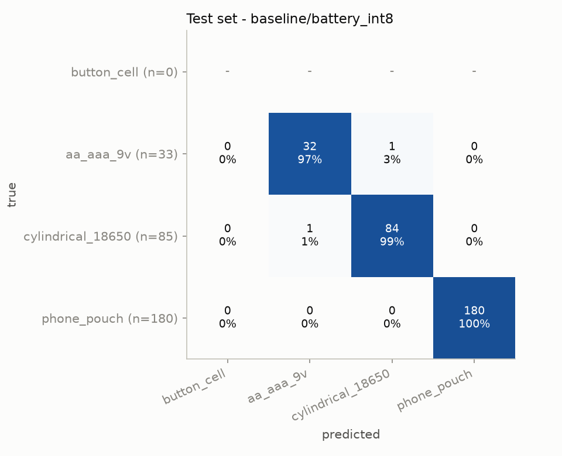
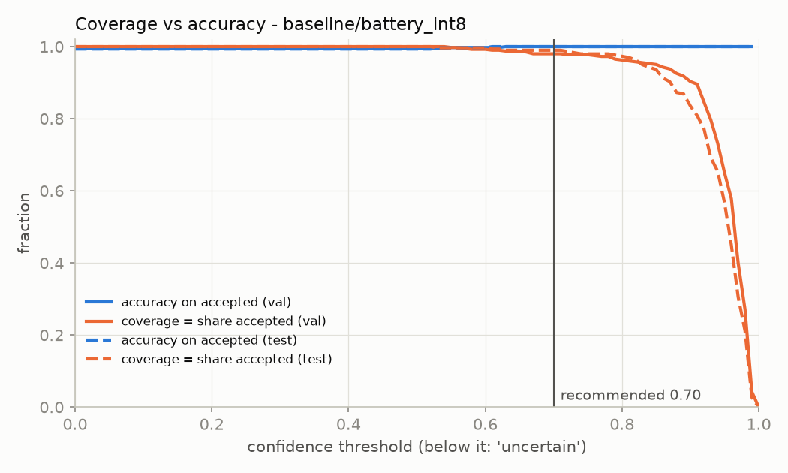
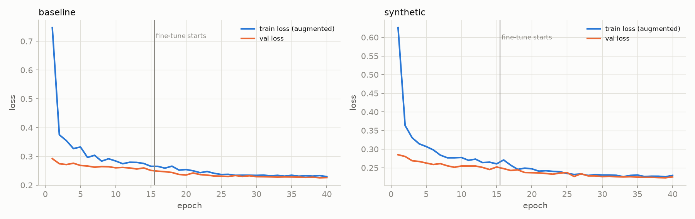

# RESULTS (auto-generated 2026-10-23T20:36:27)

Regenerated by every pipeline run. REPORT.md explains the decisions; this file holds the latest numbers.

> **button_cell metrics are UNRELIABLE.** There are no own photos of button cells yet, so button_cell is absent from val/test; its numbers below come only from held-out Wikimedia photos (web_holdout).

Shipped: **baseline/battery_int8.tflite**; int8 vs float32 test-accuracy drop: 0.00 pts
Synthetic experiment: web-holdout button recall 100.0% -> 100.0% (gain +0.0 pts); val accuracy 99.8% -> 99.8% (drop +0.0 pts) -> keep baseline

## Image counts (used images per class / source / split)

| class / source | train | val | test | web_holdout |
|---|---|---|---|---|
| aa_aaa_9v / singapore | 214 | 53 | 33 | 0 |
| button_cell / web | 86 | 0 | 0 | 24 |
| cylindrical_18650 / recybat24 | 252 | 45 | 75 | 0 |
| cylindrical_18650 / singapore | 28 | 5 | 10 | 0 |
| phone_pouch / recybat24 | 516 | 300 | 180 | 0 |

## Model comparison

| model | size KB | val acc | test acc | test macro-F1 (classes present) | web-holdout button recall (UNRELIABLE) | shortcut-diagnostic acc | threshold | test coverage @t | test acc @t |
|---|---|---|---|---|---|---|---|---|---|
| baseline/battery_float32 | 8701.1 | 99.8% | 99.3% | 0.986 | 100.0% | 88.9% | 0.70 | 99.3% | 100.0% |
| baseline/battery_int8 | 2675.8 | 99.5% | 99.3% | 0.986 | 100.0% | 88.9% | 0.70 | 99.0% | 100.0% |
| synthetic/battery_float32 | 8701.1 | 99.8% | 99.7% | 0.993 | 100.0% | 87.7% | 0.70 | 99.3% | 100.0% |
| synthetic/battery_int8 | 2675.8 | 100.0% | 100.0% | 1.000 | 100.0% | 90.1% | 0.70 | 98.7% | 100.0% |

## Per-class test metrics (baseline/battery_int8)

| class | precision | recall | F1 | support |
|---|---|---|---|---|
| button_cell (no test images - see web_holdout) | 0.000 | 0.000 | 0.000 | 0 |
| aa_aaa_9v | 0.970 | 0.970 | 0.970 | 33 |
| cylindrical_18650 | 0.988 | 0.988 | 0.988 | 85 |
| phone_pouch | 1.000 | 1.000 | 1.000 | 180 |

Overall test accuracy: **99.3%** on 298 images. False 'button_cell' alarms on test: 0.
Test accuracy by source: {"recybat24": 1.0, "singapore": 0.9535}

Web-holdout (button cells, UNRELIABLE): recall 100.0%, predicted as {'button_cell': 24}

Shortcut diagnostic (held-out cut-outs pasted on the tray; NOT the test set): accuracy 88.9%; per-class recall {"button_cell": 0.9792, "aa_aaa_9v": 0.7778, "cylindrical_18650": 0.6667}

## Threshold trade-off (validation; test dashed)

| threshold | val coverage | val acc on accepted | test coverage | test acc on accepted |
|---|---|---|---|---|
| 0.50 | 100.0% | 99.5% | 100.0% | 99.3% |
| 0.60 | 99.3% | 99.8% | 99.7% | 99.7% |
| 0.70 | 98.0% | 100.0% | 99.0% | 100.0% |
| 0.75 | 97.8% | 100.0% | 98.0% | 100.0% |
| 0.80 | 96.3% | 100.0% | 97.3% | 100.0% |
| 0.85 | 95.0% | 100.0% | 93.6% | 100.0% |
| 0.90 | 90.3% | 100.0% | 83.6% | 100.0% |
| 0.95 | 65.0% | 100.0% | 56.7% | 100.0% |

Same trade-off on the shortcut diagnostic (domain-shifted images, NOT the test set):

| threshold | diag coverage | diag acc on accepted |
|---|---|---|
| 0.50 | 90.1% | 91.8% |
| 0.60 | 82.7% | 92.5% |
| 0.70 | 74.1% | 93.3% |
| 0.80 | 60.5% | 93.9% |
| 0.90 | 28.4% | 95.7% |

Validation-calibrated threshold (lowest t with >= 98% selective accuracy): 0.00; floor 0.70; **shipped threshold: 0.70**

